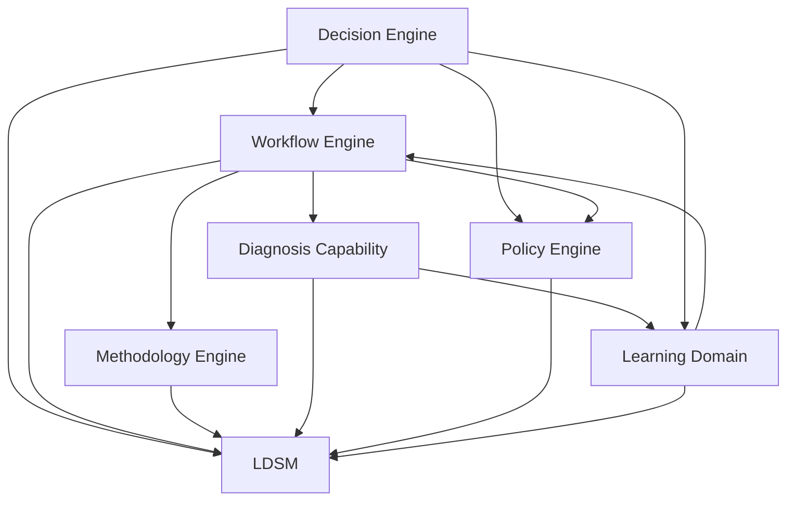

# 系统架构

## 模块

1. Decision Engine  
2. Workflow Engine  
3. Methodology Engine  
4. Policy Engine  
5. Learning Domain  
6. Diagnosis Capability  
7. LDSM（Learning Data and State Management）

## 关系（逻辑）

图源：`docs/diagrams/system-architecture.mmd`。

## 核心边界

| 角色 | 职责 |
|---|---|
| Workflow | 当前执行什么（确定性骨架） |
| Methodology | 如何引导 |
| Evidence | 哪些结论有证据 |
| Diagnosis | 形成诊断判断 |
| Decision | 下一步做什么 |
| Policy | 允许做什么 |
| Learning Domain | 拥有学习业务对象 |
| LDSM | 持久化与状态更新机制；不创造业务事实 |

**不变式（D-004）：** 业务规则不依赖 Prompt；执行成功不依赖模型转述；Agent 不是业务状态最终裁判。

详见 [module-responsibilities.md](./module-responsibilities.md)、[module-interfaces.md](./module-interfaces.md)、[cross-module-collaboration.md](./cross-module-collaboration.md)。
